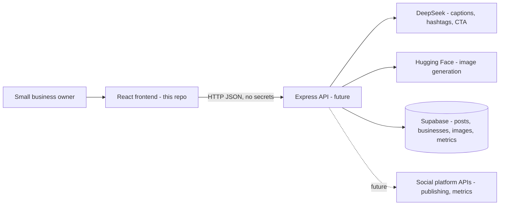
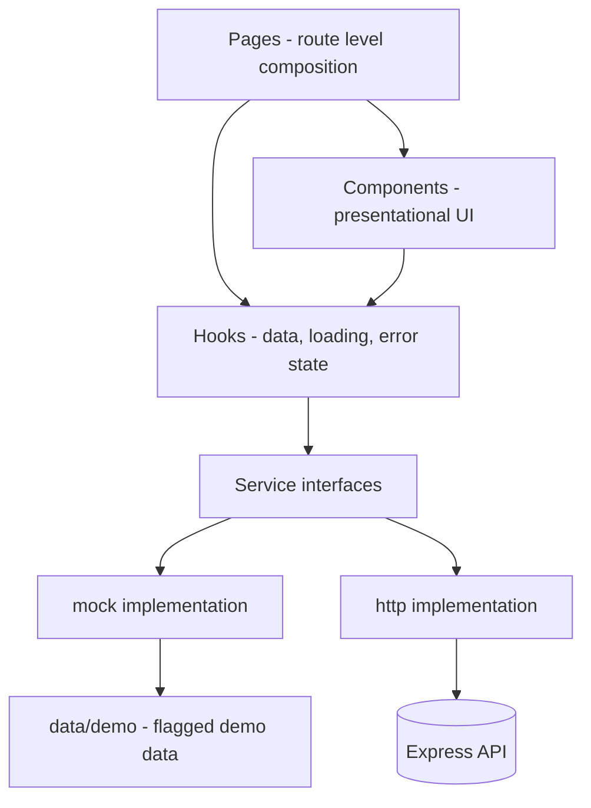
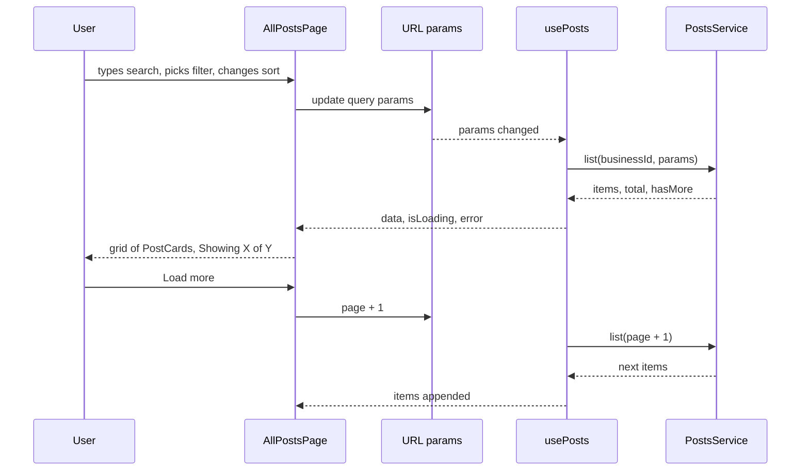
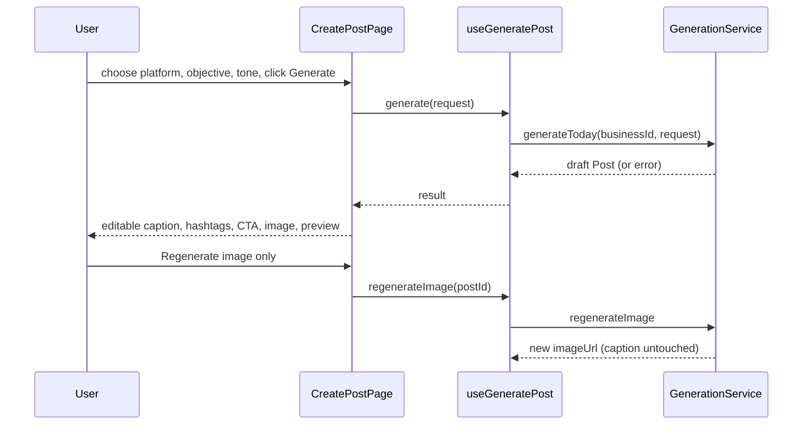
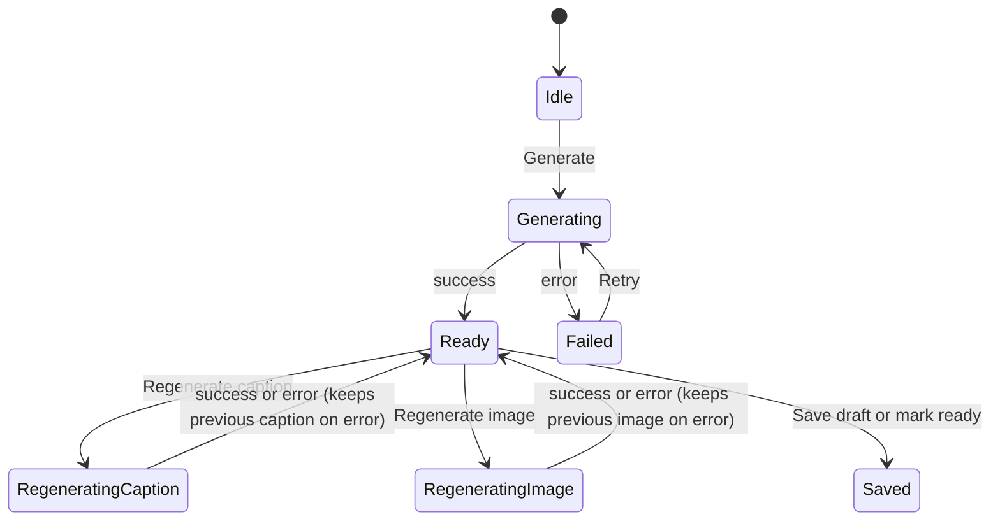

# ARCHITECTURE.md

Frontend architecture for PostDaily (working title), an AI-powered daily social media marketing platform for small businesses.

Read with `docs/PRD.md` (what to build) and `AGENTS.md` (how to work). This document explains how the frontend is structured and why, so that the future Node.js/Express backend can be connected by changing the services layer only.

## 1. Goals that shape the architecture

1. **Backend-swappable:** demo data today, real API tomorrow, no UI changes.
2. **Honest data:** a missing metric is `null` and is displayed as "Not recorded". The type system and helpers enforce this.
3. **History scales:** All Posts must work with 28 demo posts and with 500+ real ones.
4. **No secrets in the browser:** all AI and database credentials live only in the future backend.
5. **Small, reusable parts:** pages compose components, components stay presentational, logic lives in hooks and `lib`.

## 2. System context



In this repository only the frontend box exists. Until the API exists, the frontend runs against mock services and demo data.

## 3. Layered design



| Layer | Responsibility | May import from | Must not |
|---|---|---|---|
| `pages` | Route-level layout, wiring hooks to components | components, hooks, lib, types | call services or `fetch` |
| `components` | Rendering and local UI state | other components, lib, types | fetch data, import demo data |
| `hooks` | Fetching, caching, loading and error state, mutations | services, lib, types | render UI |
| `services` | Data access contract and implementations | types, lib, data/demo (mock only) | know about React |
| `data/demo` | Sample records, all `isDemo: true` | types | be imported outside `services/mock` |
| `lib` | Pure helpers (formatting, dates, clipboard, download, metrics math) | types | depend on React or services |
| `types` | Domain types | nothing | contain logic |

These import rules should be enforced with an ESLint restriction (for example `no-restricted-imports`) so violations fail the lint step.

## 4. Folder structure

```
src/
  app/
    App.tsx               providers and router mount
    router.tsx            route table
    providers/            ServiceProvider, BusinessProvider, ThemeProvider, ToastProvider
    AppShell.tsx          sidebar, mobile nav, outlet, demo banner
  components/
    ui/                   Button, Badge, Input, Select, Checkbox, Modal, Tabs, Menu, Toast, Skeleton, EmptyState
    layout/               Sidebar, MobileNav, BusinessSwitcher, UserMenu, DemoBanner, PageHeader
    posts/                PostCard, PostListItem, PostGrid, PostDetailModal, PostFilters, MetricStat, StatusBadge
    create/               ContextPanel, GenerationControls, PostEditor, PlatformPreview
    charts/               ChartCard, EngagementChart, PlatformComparison
  pages/                  DashboardPage, CreatePostPage, AllPostsPage, AnalyticsPage, ProfilePage, SettingsPage
  services/
    types.ts              service interfaces
    index.ts              selects implementation from VITE_DATA_SOURCE
    mock/                 mock implementations
    http/                 http implementations and fetch client
  data/demo/              demo businesses and posts
  hooks/                  usePosts, usePost, useBusiness, useGeneratePost, useAnalytics, useUrlState
  lib/                    metrics.ts, format.ts, dates.ts, clipboard.ts, download.ts, query-params.ts
  types/                  post.ts, business.ts, analytics.ts, generation.ts
  styles/                 index.css, token CSS variables
public/demo/              local placeholder images for demo posts
docs/                     PRD.md, ARCHITECTURE.md, API_CONTRACT.md (later)
```

## 5. Routing

| Path | Component | Notes |
|---|---|---|
| `/` | `DashboardPage` | today's status, recent posts, totals |
| `/create` | `CreatePostPage` | generation workspace |
| `/posts` | `AllPostsPage` | filters and pagination in URL query params |
| `/posts/:id` | `AllPostsPage` + `PostDetailModal` | modal route, deep-linkable; list state is preserved when closed |
| `/analytics` | `AnalyticsPage` | date range in URL query params |
| `/profile` | `ProfilePage` | business profile form |
| `/settings` | `SettingsPage` | account, appearance, notifications |

Route pages are lazy-loaded (`React.lazy`) so the initial bundle stays small. The `/posts/:id` modal is rendered by `AllPostsPage` as a child route (`<Outlet />`) so the grid stays mounted underneath and scroll position is kept.

## 6. State management

No global store is required. State is kept at the narrowest useful scope.

| State | Where | Persistence |
|---|---|---|
| Server data (posts, business, analytics) | Hooks over services (optionally TanStack Query) | Service layer |
| All Posts search, filters, sort, page | URL query params via `useUrlState` | URL, survives refresh and sharing |
| Active business | `BusinessProvider` | `localStorage` key `postdaily.activeBusinessId` |
| View mode (grid or list) | Component state hydrated from storage | `localStorage` key `postdaily.postsView` |
| Theme (light, dark, system) | `ThemeProvider` | `localStorage` key `postdaily.theme` |
| Form drafts (profile, post editor) | Local component state | Not persisted, unsaved-changes guard on leave |
| Toasts, modals, menus | Local or provider state | None |

### Hook contract

Every data hook returns the same shape so UI states are uniform:

```ts
interface AsyncResult<T> {
  data: T | undefined;
  isLoading: boolean;
  error: Error | null;
  refetch: () => void;
}
```

Mutations (save, regenerate, update profile) return `{ mutate, isPending, error, reset }`.

## 7. Service layer

Services are plain TypeScript interfaces. The active implementation is chosen once in `services/index.ts`:

```ts
// services/index.ts
const source = import.meta.env.VITE_DATA_SOURCE ?? 'mock';
export const services: Services = source === 'api' ? httpServices : mockServices;
```

```ts
// services/types.ts
interface PostsService {
  list(businessId: string, params: ListPostsParams): Promise<ListPostsResult>;
  get(postId: string): Promise<Post>;
  update(postId: string, patch: PostPatch): Promise<Post>;
}

interface GenerationService {
  generateToday(businessId: string, req: GenerationRequest): Promise<Post>;
  regenerateCaption(postId: string): Promise<Pick<Post, 'caption' | 'hashtags' | 'cta'>>;
  regenerateImage(postId: string, visualPrompt?: string): Promise<Pick<Post, 'imageUrl' | 'visualPrompt'>>;
}

interface AnalyticsService {
  summary(businessId: string, range: DateRange): Promise<AnalyticsSummary>;
}

interface BusinessService {
  list(): Promise<BusinessProfile[]>;
  get(id: string): Promise<BusinessProfile>;
  update(id: string, patch: Partial<BusinessProfile>): Promise<BusinessProfile>;
}
```

### Mock implementations

- Read from `data/demo`, keep an in-memory copy so edits and new posts work during a session.
- Simulate latency (300 to 900ms) and an optional failure rate so loading, error and retry states can be tested.
- Mock generation returns clearly labelled sample content and local placeholder images, never calls the network.
- Implement the same filtering, sorting and pagination semantics the real API must provide.

### HTTP implementations

- Use one `apiClient` wrapper around `fetch` using `VITE_API_BASE_URL`.
- Add an auth header from a token provider when authentication exists (no secrets in the bundle).
- Map HTTP errors to typed `ApiError` (`network`, `unauthorized`, `notFound`, `validation`, `server`) so hooks and UI can show specific messages.
- Endpoint contract is listed in `docs/PRD.md` section 9 and will be expanded in `docs/API_CONTRACT.md`.

## 8. Domain model and the null rule

Types live in `src/types`. The key rule: **`null` means not recorded, `0` means recorded as zero.**

```ts
interface PostMetrics {
  likes: number | null;
  shares: number | null;
  comments: number | null;
  reach: number | null;
  clicks: number | null;
  recordedAt: string | null;
}
```

All metric math goes through `lib/metrics.ts`, never inline in components:

- `engagementOf(post)` returns `null` when no engagement value is recorded, otherwise the sum of recorded likes, shares and comments.
- `sumRecorded(posts, key)` sums only non-null values and also returns how many posts contributed.
- `compareByEngagement` sorts posts with no recorded engagement last.
- `formatMetric(value)` returns `'Not recorded'` (or a dash in compact views) for `null`.

This keeps the "no fabricated numbers" rule in one testable place.

## 9. Key data flows

### 9.1 All Posts listing



- Page size is 12. "Load more" appends the next page; the total from the service drives "Showing X of Y".
- Search is debounced (about 300ms) before it touches the URL.
- Changing any filter, search or sort resets `page` to 1.
- Cards use stable image aspect ratios and `loading="lazy"` so long lists do not cause layout shift.

### 9.2 Create Today's Post



Generation state machine (caption and image tracked independently):



Rules:

- If a post already exists for today and the active business, the page loads it and offers Regenerate, rather than creating a duplicate.
- A failed image never discards a good caption, and vice versa.
- Publishing is not implemented. The Publish button is disabled with an explanation until a real integration confirms publishing.

### 9.3 Dashboard and Analytics

Both read through `PostsService` and `AnalyticsService`, then use `lib/metrics.ts` for totals. Charts render only when the minimum data threshold is met (Dashboard: at least 3 posts with recorded metrics). Otherwise an explanatory empty state is shown. Every chart or total states how many posts contributed.

## 10. UI composition principles

- **Presentational components** take props and callbacks, no data fetching. `PostCard` receives a `Post` and action handlers.
- **Reusable metric display:** `MetricStat` (icon, label, value) handles `null` formatting once, used in cards, the detail modal, dashboard and analytics.
- **Empty, loading and error states** use shared `EmptyState`, `Skeleton` and an error panel with a retry button.
- **Compound components** for `Modal`, `Tabs`, `Menu` handle focus, keyboard and ARIA.
- **Platform previews** (`PlatformPreview`) are separate small components per platform (Instagram, Facebook, LinkedIn, X) behind a single prop-driven wrapper.

## 11. Styling and theming

- Tailwind with design tokens exposed as CSS variables, so light and dark themes switch by changing variables on the root element.
- Token set: background `#FAF8F4`, surface `#FFFFFF`, border `#E8E4DC`, text `#1F2421`, muted `#6B6F6A`, accent `#2F7D5B`, plus status colors.
- Theme is applied before first paint (small inline script or early effect) to avoid a flash.
- Motion limited to short transitions, disabled under `prefers-reduced-motion`.

## 12. Demo data isolation

- All demo records live in `src/data/demo` and carry `isDemo: true`.
- Only `services/mock` imports from `data/demo` (enforced by lint).
- `DemoBanner` renders whenever `VITE_DATA_SOURCE=mock`. `PostCard` shows a "Demo" badge when `post.isDemo`.
- Demo images are local files in `public/demo`, so the mock mode needs no network.
- Demo set includes about 28 posts on consecutive days, mixed platforms and statuses, some with `null` metrics, and one failed post with a reason, so pagination, filters and empty metric states can be tested.

## 13. Error handling

| Situation | Behavior |
|---|---|
| List or detail fetch fails | Inline error panel with Retry; page chrome stays usable |
| Generation fails | Error message with Retry; keeps existing edited content |
| Save or update fails | Toast with message, form keeps user input |
| Unknown post id on `/posts/:id` | "Post not found" state with link back to All Posts |
| Missing image | Neutral placeholder with alt text, never a broken image icon |
| Unexpected render error | Route-level error boundary with reload option |

No error path may silently show success or fall back to invented data.

## 14. Security

- No API keys, tokens or secrets in code, env files, comments or docs. The frontend only knows `VITE_DATA_SOURCE` and `VITE_API_BASE_URL`.
- AI providers (DeepSeek, Hugging Face) and Supabase service keys are used only by the backend.
- User-supplied text (captions, profile fields) is rendered as text, never as raw HTML. Avoid `dangerouslySetInnerHTML`.
- Image downloads use the image URL or blob returned by the service; no cross-origin credentials are sent.
- When authentication is added, the token provider lives behind `apiClient` and no UI code reads tokens directly.

## 15. Performance

- Route-level code splitting; charts library loaded only on pages that use it.
- Paginated list with Load more; images lazy loaded with fixed aspect ratio.
- Memoize `PostCard` (stable props and handlers) so appending a page does not re-render earlier cards.
- Debounced search; derived values (filtered counts, totals) computed in hooks, not in render loops.
- If history grows into the thousands, consider list virtualization in list view as a later enhancement.

## 16. Testing strategy

| Level | What | Tooling |
|---|---|---|
| Unit | `lib/metrics.ts` null handling, sorting, date helpers, query-param parsing | Vitest |
| Service | Mock `list` filtering, sorting and pagination semantics | Vitest |
| Component | `PostCard` renders "Not recorded" for null, Show more toggle, actions fire | Vitest + Testing Library |
| Manual or browser | Each phase's acceptance criteria at 375, 768, 1024, 1440px; keyboard pass; console clean | Antigravity browser verification |

The mock and http implementations should share the same contract tests where practical, so switching to the real API does not change behavior.

## 17. Moving from mock to real backend

1. Implement the endpoints in the Express API per `docs/PRD.md` section 9.
2. Finish `services/http/*` against the contract, including error mapping.
3. Set `VITE_DATA_SOURCE=api` and `VITE_API_BASE_URL=<backend url>`.
4. Confirm no page, component or hook changes were needed. If they were, the layering was violated and should be fixed.

Backend responsibilities that the frontend relies on:

- Enforce one daily post per business per date.
- Store generated images (Supabase Storage) and return stable URLs.
- Return `null` for any metric not reported by a real source.
- Only set status `published` after a real publishing integration confirms it.
- Perform all DeepSeek and Hugging Face calls server-side.

## 18. Key decisions and trade-offs

| Decision | Reason | Trade-off |
|---|---|---|
| Service interfaces with mock and http implementations | Backend can be swapped without UI changes | Slight upfront structure |
| Filters and pagination in URL params | Shareable, refresh-safe, back button works | More URL parsing code |
| Load more instead of numbered pages | Better for browsing a growing visual history | Deep jumps to old posts rely on filters and date range |
| `null` vs `0` for metrics | Prevents fabricated or misleading numbers | Every consumer must handle `null` (centralized in `lib/metrics.ts`) |
| No global store | App state is mostly server data and URL state | Add a store only if cross-page client state grows |
| Modal as a child route | Deep-linkable detail view that preserves list state | Slightly more routing setup |
| One daily post per business per date | Matches the product promise and avoids duplicate clutter | Multi-platform variants are deferred |

## 19. Extension points

- **More platforms:** add to the `Platform` union, a preview component, and a platform icon mapping.
- **Post versions:** add a `versions` field and a history panel; services unchanged except for a `listVersions` method.
- **Real publishing and metrics sync:** new `PublishingService` interface; status and metrics come from the API only.
- **Authentication:** token provider inside `apiClient`, route guards in `app/router.tsx`.
- **Team accounts:** extend `BusinessService` and the business switcher; roles handled by the backend.
